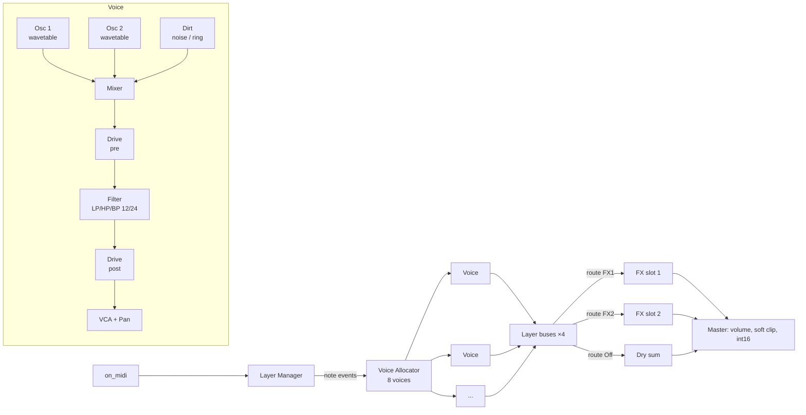

# 03 — DSP Architecture

## 1. Top-level signal flow



All internal processing is **32-bit float**, stereo after the pan stage, converted
to int16 with a soft clipper at the very end.

## 2. Core data model

```
Instance
 ├─ GlobalParams    (master vol, layer mode, layer count, FX1, FX2, voices, bend, glide…)
 ├─ Layer[4]        (LayerParams: osc, dirt, filter, env×3, lfo×2, mod×8, amp, pan, flavour, route)
 ├─ Voice[MAX_VOICES]  (runtime state; bound to one layer while sounding)
 ├─ LfoState[4][2]  (global-phase LFO state per layer)
 ├─ FxSlot[2]       (FX type + state, preallocated for the largest algorithm)
 └─ Smoothers       (one-pole per continuous param, per layer)
```

`MAX_VOICES` = 16 compiled, `voices` param limits active count (default 8).

## 3. Layer manager & voice allocation

### 3.1 Layer modes

| Mode | Behaviour on note-on |
|------|----------------------|
| **Stack** ("All") | One voice per *enabled* layer. A note on 3 layers uses 3 voices. |
| **Round Robin** | Next enabled layer in order L1→L2→…; one voice. |
| **Random RR** | Random enabled layer (no immediate repeat when ≥ 2 layers). |
| **Key Split** | Layer chosen by note range (`lN_key_lo`..`lN_key_hi`). Overlaps stack. |
| **Channel** | Layer N listens on MIDI channel (base + N − 1). For external controllers. |

Each layer also has `lN_on` (enable) and `lN_voices` reserve (0 = shared pool).

### 3.2 Allocation & stealing

1. Find a free voice (prefer one last used by the same layer → retains filter state warmth).
2. Else steal: oldest voice in release stage → oldest voice of the same layer →
   oldest overall.
3. Steal uses a 2 ms fast fade before retrigger (no click).
4. Mono/legato per layer: `lN_poly` = Poly / Mono / Legato. Mono uses last-note
   priority and the layer's glide.

### 3.3 MIDI handling

| Message | Action |
|---------|--------|
| Note on/off | Layer manager |
| Poly AT `0xA0` | Per-voice `PolyAT` mod source (Move pads) |
| Channel AT `0xD0` | `ChanAT` source; also feeds `PolyAT` of all voices when no poly AT seen |
| Pitch bend | Global bend range (default ±2, MPE per-voice ±48) |
| CC1 | `ModWheel` source |
| CC2, CC4, CC11 | `Breath`, `Foot`, `Expr` sources |
| CC64 | Sustain |
| CC74 | `Timbre` (MPE Y) |
| CC120 | All Sound Off for the receiving MIDI channel |
| CC121 | Reset controllers |
| CC123 | All Notes Off for the receiving MIDI channel |

MPE (v0.3): per-channel bend/pressure/timbre mapped to the voice owning that
channel; requires `default_forward_channel: -2`.

## 4. Oscillators

### 4.1 Wavetable model (Microwave-style)

- A **wavetable** = 64 wave slots × 128 samples, **signed 8-bit**.
- Slots 0–60 are the table's own content (keyframes + precomputed
  in-betweens). Slots **61, 62, 63** are always Triangle, Square, Saw (classic waves
  available in every table).
- In-between waves are generated **offline at build time** (linear interpolation
  between keyframes, then re-quantised to 8 bit). Switching wave position is
  therefore **stepped**: position 23.7 plays wave 23. This stepping is a core part
  of the character and is preserved.
- **Modulation range:** wave modulation (envelope, LFO, velocity, aftertouch,
  matrix, flavour) scans only the table content, clamped to **0–60**. The classic
  slots 61–63 are reachable only by setting the base Wave knob there, in which case
  modulation is ignored. (Found with the emulator: preset 15's envelope sweep fell
  through Tri → Square → Saw at the end of its attack.)
- **Cycle-aligned switching:** a new wave index takes effect when the oscillator
  phase wraps (start of the next cycle), never mid-cycle. Steps stay audible as
  timbre changes but do not add waveform discontinuities (clicks/zipper).
- Storage: N tables × 64 × 128 bytes = 8 KB per table. 64 tables = 512 KB, fine.

### 4.2 Playback — Vintage mode (default)

The original ASIC plays 8-bit samples with no interpolation at a high internal
rate (the Protein runs its engine at ~250 kHz), then the output is filtered. We
approximate:

1. Phase accumulator (32-bit, wraps at 128 samples × 2^24 fraction).
2. **Nearest-sample (zero-order hold)** lookup of the int8 sample.
3. Run oscillators at **4× oversampling** (176.4 kHz) and decimate with a
   polyphase half-band FIR (2 stages, 2× each) before the filter.
4. Wave index updates once per oversampled sample → stepping is audible as in
   hardware.

Cost estimate: 2 osc × 4× × table lookup ≈ trivial; the decimator dominates
(~16 MACs/sample per voice after NEON). Budget in §10.

Option to evaluate during prototyping: 2× instead of 4×. Choose by listening
test against reference recordings (see 08).

### 4.3 Playback — Clean mode (v0.3)

Per-table mip-maps (band-limited per octave, built offline) + linear interpolation
at 1×. Used for pads and low-aliasing patches. Switch per layer: `lN_osc_mode`.

### 4.4 Oscillator parameters (per osc)

`table`, `wave` (0–63, modulatable), `semi` (−48..+48), `fine` (±100 cents),
`level`, `wenv` (Wave-envelope amount to `wave`, bipolar), `vel` (velocity → `wave`
amount, bipolar), `kbd` (keytrack on/off for drones). Osc 2 has `link`: when on, Osc
2 uses Osc 1's `table` and follows Osc 1's wave modulation, keeping only its own
offset — the Protein's "link oscillators" behaviour.

### 4.4.1 Cross modulation (Osc 2 → Osc 1)

Amino extension. One-way only: Osc 2 is the modulator, Osc 1 the carrier/slave.
Osc 2 is still heard at its own `level` (set it to 0 for a pure modulator).
Params `xmod_type` (Off, PM, AM, Sync) and `xmod` (0..1, matrix target `XMod`).

| Type | Per oversampled sample | `xmod` controls |
|------|------------------------|-----------------|
| PM | Osc 1 read position += `o2 · 1.5 · xmod²` cycles (DX-style "FM"; pitch-stable) | index, 0 → ≈ 9.4 rad |
| AM | `o1 ·= 1 − xmod · (0.5 − 0.5 · o2)` (unipolar; bipolar ring is Dirt → Ring) | depth |
| Sync | Osc 1 phase restarts when Osc 2 wraps (fractional offset kept) | Osc 1 pitch rise, 0 → +36 st (the sync sweep) |

- Order per sample: Osc 2 first, then Osc 1. Because it is one-way, Osc 2 can be
  rendered for the whole block into a buffer first, keeping both loops
  NEON-vectorisable.
- A sync reset counts as a cycle start for cycle-aligned wave switching (§4.1).
- **Vintage:** runs inside the existing 4× oversampled loop; residual aliasing is
  part of the character.
- **Clean:** PM and Sync add partials the mip-maps do not account for. Voices with
  `xmod_type ≠ Off` run their oscillators at 2× through the Vintage decimator's
  second half-band stage, and read the mip level selected for 2× the carrier pitch
  (one octave darker) to leave headroom for the added sidebands.
- Cost: ≈ 3 extra ops per oversampled sample per voice (PM: mul, add, wrap) —
  ≈ 4 k MACs per 128-frame block at 8 voices, a few µs (§14).

### 4.5 Pitch section

- Layer `octave`, `glide` time, glide mode (Off / On / Legato).
- **Scale quantise** (v0.3): quantises note + pitch modulation to a scale; scale &
  root default to Move's set (`move_info_read` → `root_note`, `scale`), override
  possible.
- **Chord** (v0.3): one note-on spawns a chord (Maj, Min, 7, m7, sus2, sus4, 5th,
  Oct…) inside the layer; voices drawn from the pool.

## 5. Dirt (noise & ring)

Per voice, mixed pre-filter. Types:

| Type | Algorithm |
|------|-----------|
| Static | White noise, xorshift32 per voice |
| Crackle | Sparse random impulses, density ∝ amount, random amplitude |
| Geiger | Poisson clicks, very short decaying bursts |
| Click | One short transient at note-on (attack click) |
| Burst | Noise gated by a fast random envelope (~20–80 ms bursts) |
| Ring | Ring modulation Osc1 × Osc2 (replaces noise) |

Params: `dirt_type`, `dirt` (level). Dirt level is a mod target.

## 6. Drive

Shapers selectable: Off, Transistor (asymmetric tanh), Tube (soft-asym with bias),
Diode (hard-knee clip), Fold (extra). Params: `drv_type`, `drive` (0–1), `drv_pos`
(Pre-filter / Post-filter). When the filter type is **Off**, drive acts as the
Protein's "drive instead of filter". Runs at 1× with a cheap 2× oversampled
polynomial when `drive > 0.5` (decide by CPU test).

## 7. Filter

- Topology: **TPT/ZDF 4-pole OTA cascade** (CEM3320-flavoured) with per-stage
  `tanh` saturation, resonance feedback with gain compensation.
- Modes: LP24, LP12, Ladder 24dB, HP24, HP12, BP12, Off. State v1 stored the
  ladder last as "Moog" (index 6); params.c remaps v1 blobs on load.
- **Ladder 24dB** is a four-pole ladder in trapezoidal (ZDF) form with a `tanh` on every
  stage input, after Huovilainen's improved Moog model; the delay-free feedback
  loop is solved from the linear response (Zavalishin), so no unit-delay
  feedback, no oversampling and about five cheap `tanh` per sample. Feedback
  `k = 4.5 * res` (self-oscillation from about `res` 0.89, started by a -80 dB
  DC kick) and only partial make-up gain (`1 + 0.3k`), so the passband sags with
  resonance as on the hardware. LP24 keeps its full gain compensation.
- Cutoff in semitones (MIDI note 0–127 → Hz), audio-rate modulation allowed
  (coefficients updated every 4 samples with interpolation).
- Params: `cutoff`, `res`, `fenv` (bipolar), `fkbd` (0–200 %), `fvel` (bipolar).

## 8. Envelopes

Four ADSR per voice: **Wave env (E1)**, **Filter env (E2)**, **Amp env (E3)** and
a free **Aux env (E4)**. E4 has no fixed destination: it drives up to two
dedicated routes (`e4_dst1/2`, `e4_amt1/2`, 04 §3.10), added to the target in
the matrix's first pass (before the LFOs update, using last block's E4 like a
matrix slot), or can be picked as *Aux Env* in the mod matrix (or as Via). It
shares the envelope shapes and times of E1-E3.

Each LFO also has a dedicated pitch route, `lfoN_pitch` (±12 semitones at
±100%), summed with Aftertouch → Vibrato into the common pitch offset and
scaled by the *LFO Depth* targets.

- Exponential segments (analog feel), times 0 ms – 20 s on a curved scale:
  `t = 20 s · x³` for knob value `x` in 0..1.

  | x | 0.05 | 0.1 | 0.15 | 0.2 | 0.25 | 0.3 | 0.35 | 0.4 | 0.5 | 0.6 | 0.7 |
  |---|------|-----|------|-----|------|-----|------|-----|-----|-----|-----|
  | t | 2.5 ms | 20 ms | 68 ms | 160 ms | 310 ms | 540 ms | 860 ms | 1.3 s | 2.5 s | 4.3 s | 6.9 s |
- Retrigger from current level (no reset to 0) to avoid clicks.
- Velocity → Amp level via `amp_vel`.
- Envelope stage times are mod targets (Protein allows LFO → decay).

## 9. LFOs

Two per layer.

| Param | Values |
|-------|--------|
| `shape` | Sine, Tri, Pulse, Saw↓, Saw↑, Random (smooth), S&H |
| `rate` | 0.01–50 Hz (free): `f = 0.01 · 5000^x` (x 0.3 → 0.13 Hz, 0.5 → 0.71 Hz, 0.6 → 1.65 Hz, 0.7 → 3.9 Hz) |
| `div` | Musical division used when synced |
| `sync` | Off / On (uses `get_beat_position`; free-runs if NULL or stopped) |
| `phase` | Free / Voice (retrig per note) / Global (one phase for the layer) |
| `fade` | Fade-in time |
| `mw` | ModWheel → depth link (Protein "mod-wheel linked LFO" variant) |

Not audio-rate (control rate is enough and saves CPU).

## 10. Modulation matrix

8 slots per layer: `src`, `dst`, `amt` (−100..+100 %), `via` (optional scaler
source, default Off), and `via_depth` (0..100%, default 100%). The effective
route amount is `amt × (1 − via_depth + via_depth × via_signal)`. Thus 0%
ignores Via and leaves the route unchanged; 100% preserves the original
full-strength Via multiplier. Existing patches keep their sound because the
new parameter defaults to 100%.

**Sources (27, Aux Env last):** Off, Wave Env, Filter Env, Amp Env, LFO1, LFO2, LFO1×MW,
LFO2×MW, Velocity, Release Vel, Key (keytrack), Poly AT, Chan AT, ModWheel, Breath,
Foot, Expression, Pitch Bend, Timbre (CC74), Sustain, Random (per note),
Random Bipolar, Voice # (spread), Layer Alternate (±1 per note), Constant, Flavour,
Aux Env (E4).

**Targets (25):** Pitch (both), Osc1 Pitch, Osc2 Pitch, Osc1 Wave, Osc2 Wave,
Osc1 Level, Osc2 Level, Dirt Level, Cutoff, Resonance, Drive, Pan, Amp Level,
LFO1 Rate, LFO2 Rate, LFO1 Depth*, LFO2 Depth*, E1 Decay, E2 Decay, E3 Decay,
E1 Attack, E3 Release, Glide, FX Send, XMod.

(*LFO depth targets scale every slot whose source is that LFO.)

Evaluation: **control rate = every 16 samples** (2.76 kHz), linear-interpolated
per sample for Pitch, Wave, Cutoff, Amp. Matrix evaluation is a flat loop over
configured slots only (slots with `src=Off` or `dst=Off` are skipped via a
precomputed active list rebuilt on `set_param`; continuous amounts can smooth
through zero).

Interaction with Schwung modulation (scenes/chain LFOs): the host overlays its
modulation on our **base** parameter values via `set_param`; our matrix adds on
top. `get_param` always returns the base value.

## 11. Amp, pan, flavour

- VCA: E3 × `amp_lvl` × velocity curve × layer volume.
- Pan modes: Fixed, Random (per note), Alternate (L/R), Spread (by voice #),
  LFO1, LFO2. `pan` sets centre/width.
- **Flavour**: on note-on draw seeded random offsets (seed = layer, note, voice
  counter) for wave position (± up to 3 slots), pitch (± up to 12 cents), env times
  (± up to 8 %), cutoff (± up to 1 semitone), all scaled by `flavour` amount.

## 12. Effects

Full specification: [11-effects.md](11-effects.md). Summary:

- Two global slots, each any of: Chorus, Flanger, Phaser, Tremolo, Drive,
  Compressor, EQ, Delay, Reverb (Protein's set), with `type`, `mix`, `p1`..`p6`.
- Per-slot 800 KB arena preallocated in `create_instance`; type changes fade and
  clear incrementally, never allocate.
- Each layer: `route` = Dry / FX1 / FX2 and `send`. Global `fx_chain` defaults
  to Serial (FX1 → FX2); Parallel remains selectable.
- Amino extensions over the Protein: any type in both slots, serial chain, Drive
  Crush mode, Tremolo Pump shape, Reverb Freeze, EQ Q + Low Cut, and a 10th type,
  **Shimmer** (pitch-shifted reverb feedback).
- FX are **not** matrix targets (as Protein), except `send`, but are reachable by
  Schwung scenes/LFOs/automation through `chain_params`.

## 13. Parameter smoothing

- Continuous layer params: shared per-layer one-pole smoother, τ = 8 ms (including
  filter, envelope, dirt, drive, oscillator levels and modulation amounts).
- Enum/discrete: applied at next block boundary; table changes crossfade 5 ms
  per voice to avoid clicks.
- `set_param` only writes a target value + dirty flag. **No heavy work in set_param**
  (scenes may call it every block for many keys).

## 14. CPU budget (target, per 128-frame block)

| Block | Estimate | Notes |
|-------|----------|-------|
| 8 voices × 2 osc @4× + decimator | 120 µs | NEON decimator; cross-mod (§4.4.1) adds ≈ 5 µs |
| 8 voices filter (TPT, tanh) | 90 µs | |
| 8 voices env/LFO/mod @ control rate | 30 µs | |
| Dirt + drive + pan | 30 µs | |
| FX1 + FX2 (worst: reverb + delay) | 180 µs | two reverbs: 220 µs (11 §5) |
| Mixing, smoothing, output | 20 µs | |
| **Total** | **≈ 470 µs** | ≈ 16 % of 2.9 ms block |

Mitigations if over budget: 2× osc oversampling, filter coeff update every 8
samples, idle voices skipped (silent after release + 1 block), FX bypass when
mix = 0 and tail decayed.

### 14.1 16-voice option

Voice-dependent cost is ≈ 270 µs per 8 voices, so 16 voices ≈ 740 µs total
(≈ 25 % of the block) — above NFR-2. Policy:
- `voices` max is 16; default 8.
- 16 is only offered if M0 measures ≤ 600 µs worst case for 16 voices (e.g. with
  2× osc oversampling for voices 9–16 or under a CPU guard).
- **CPU guard:** if a block's render time exceeds a threshold for N consecutive
  blocks, the allocator stops granting voices above 8 until load drops (no
  audible cut of sounding voices; new notes steal instead).

## 15. Sample-rate & block assumptions

44 100 Hz and 128 frames are assumed constant but **read from `host_api_v1_t`** at
init; all time constants are derived, not hard-coded.
