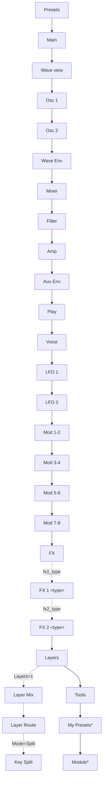
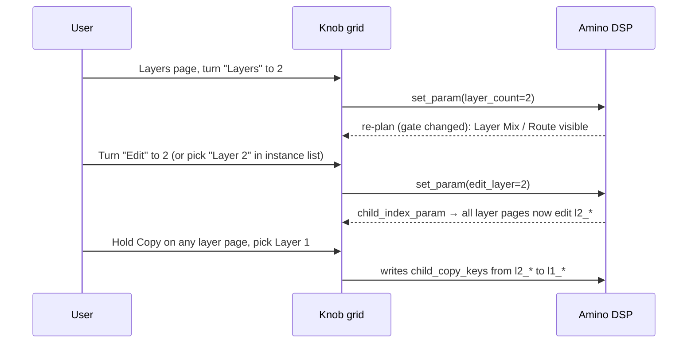

# 05 — UX & Move Control Design

This is the core of the project: making a deep 4-layer synth pleasant to edit with
eight knobs and a 128×64 screen.

## 1. Design principles

1. **Eight knobs, one idea.** Every page answers one question ("how does the
   filter move?") and puts all its knobs on screen at once. No hidden
   Select-knob sub-parameters as on the Protein.
2. **Envelopes live with what they modulate.** Wave env on the wave page, filter env
   on the filter page, amp env on the amp page — drawn as envelopes.
3. **Rows mean something.** Top row = the sound source/shape; bottom row = how it
   moves or responds. Viz groups always occupy a whole row of four.
4. **Same knob, same job.** Across Osc 1 / Osc 2, LFO 1 / LFO 2 and Mod pages,
   knob *n* always does the equivalent thing, so muscle memory transfers.
5. **Simple until you ask.** With one layer active, no layer UI exists. Multi-layer
   pages appear only when `Layers > 1`.
6. **Pads are performance notes by default.** Amino's Pad Matrix is the one
   screen that captures them; its custom UI forwards pad notes to Move on every
   other page. Steps, arrows and transport remain Move-owned.
7. **Two gestures to anything.** Shift+jog-click opens the section picker; choosing
   a section lands on its first page.
8. **Pre-wired expression.** Aftertouch routes have dedicated knobs; you never need
   the mod matrix to make pads expressive.

## 2. Controls available (host-owned, behaviour we inherit)

| Control | Action in Amino |
|---------|-----------------|
| Knobs 1–8 | Edit the 8 params of the current page |
| Touch a knob | Header shows full name + value (e.g. `Osc 1 Wave Position  37`) |
| Shift + turn | Fine adjust |
| Jog turn | Next / previous page |
| Jog click (on preset page) | Enter preset browser |
| Shift + jog click | Section picker |
| Hold knob + jog click (enum) | Open option list |
| Back | Leave Amino UI |
| Hold Copy + pick layer | Copy focused layer → picked layer |
| Hold Delete + pick layer | Init picked layer |
| Undo | Undo last layer copy/clear |
| Pads | Play notes + poly aftertouch; select matrix fields on Pad Matrix |

## 3. Navigation map



`*` appended automatically by Schwung. Dotted = hidden by `visible_if`.

Section picker groups (what Shift+click shows): **Presets · Main · Oscillators ·
Filter & Amp · Play · Modulation · Effects · Layers · Tools**.

## 4. Page specifications

Notation: `[k1 k2 k3 k4 | k5 k6 k7 k8]` — top row | bottom row.
`(viz:X)` = drawn as graphic. Layer pages edit the **focused layer** (`edit_layer`);
the device header identifies both page and layer, e.g. `Filter (L1)`.

### 4.1 Presets
Preset browser (`list_param: preset`, `count_param: preset_count`,
`name_param: preset_name`). Jog browses, click enters/auditions, Back leaves.
Knobs remain mapped to the Main page params while browsing (host behaviour), so a
preset can be tweaked mid-browse.

### 4.2 Main — "the 8 knobs you want"
`[Cutoff Res Wave1 Wave2 | F.Env Attack Release Flavour]`
- Wave1/2 = `osc1_wave`, `osc2_wave` (big number display).
- Cutoff/Res drawn as filter curve (viz:filter, mode from `ftype`).
- Attack/Release = Amp env A and R.
- Flavour = layer flavour.

### 4.3 Wave view (canvas page, v0.3)
`as_page: true`, `canvas_script: "wave.js"`. Same knobs as Osc pages' top rows:
`[O1 Table  O1 Wave  O2 Table  O2 Wave | O1 Semi  O2 Semi  O1 Level  O2 Level]`

Body band drawing:
```
┌────────────────────────────────────────────┐
│ Osc1 wave (128 px, one px per sample)      │  ← solid line
│ Osc2 wave overlaid                         │  ← dotted line
│ ▮▮▮▮▮▮▮▮▮▮▮▮▮▮░░░░░░░░░░░░░░░░ 37/63  │  ← position bar, live
│ T1:Resonant      T2:Formant                │
└────────────────────────────────────────────┘
```
Data: `extra_keys: ["wave_view", "wave_view2"]` (hex-encoded current wave, 64
points), wave positions via `live: true` → `:effective` so modulation animates.
Table names come from a generated JS array shipped with the module.

### 4.4 Osc 1 / Osc 2
`[Table Wave Semi Fine | Level WEnv Vel Kbd]`
Osc 2: `[Table Wave Semi Fine | Level Link XMode XMod]` — Osc 2 is the cross-mod
source, so its page carries the cross-mod controls; its WEnv and Vel stay
reachable on the Wave Env (§4.5) and Play (§4.9) pages.
- `Table` is an enum: hold + click opens the scrolling table list.
- `Semi` uses `display: big`.
- `Link` is a switch (Off/On).

### 4.5 Wave Env
`[Attack Decay Sustain Release (viz:envelope e1) | O1 Wave O1 WEnv O2 Wave O2 WEnv]`
Turn the bottom row while holding a note to hear the sweep range immediately.

### 4.6 Mixer
`[O1 Level O2 Level DirtType Dirt | DrvType Drive DrvPos Volume]`
- O1/O2 Level as faders (viz:fader).
- `Dirt` short options: `Stat Crkl Geig Clik Brst Ring`.

### 4.7 Filter
`[Cutoff Res Env Type (viz:filter) | Attack Decay Sustain Release (viz:envelope e2)]`
The whole filter behaviour on one page.

### 4.8 Amp
`[Attack Decay Sustain Release (viz:envelope e3) | Volume AmpVel PanMode Pan]`

### 4.8a Aux Env
`[Attack Decay Sustain Release (viz:envelope e4) | Dst1 Amt1 Dst2 Amt2]`
The bottom row is the Aux envelope's two dedicated routes (04 §3.10): pick a
target, set a bipolar amount, no matrix slot needed. Turning an Amount raises
the route card (`cards.js#aux_amt_card`: `Aux Env > Cutoff`, bipolar bar, `+25.0%`).

### 4.9 Play — expression on pads
`[Vel→W1 Vel→W2 Vel→Flt Vel→Amp | FltKbd AT→Wave AT→Cut AT→Vib]`
Uses dedicated expression routes (04 §3.9), independent of the 8 matrix slots.
This page exists because Move's pads have polyphonic aftertouch; it makes
pressure-driven sounds a 4-knob job.

### 4.10 Voice
`[Octave Poly Glide Flavour | Scale Chord Char Send]`

### 4.11 LFO 1 / LFO 2
`[Shape Rate Div Sync | Phase Fade MW Pitch]`
- Shape drawn as waveform (viz:waveform).
- Both `Rate` (Hz) and `Div` (musical) are shown; `Sync` picks which is used. This
  avoids spending `visible_if` gate budget (max 4) on LFO sync.
- `Pitch` is the dedicated LFO → pitch route (04 §3.7): ±12 semitones at ±100%.
  With `MW` On it is classic mod-wheel vibrato. Same knob on both LFO pages.

### 4.12 Mod Matrix and Mod 1-2 … Mod 7-8

The **Pad Matrix** page is an additional custom page; the original Mod 1-2 …
Mod 7-8 knob pages remain available for now. Each pad column represents one of
the eight slots. From top to bottom, the rows select Source, Via, Destination,
and Via Depth. The knob above a column adjusts that slot's Amount; selecting
Via Depth makes that column's knob adjust the Via blend instead. Jog changes the
selected source/Via/target, and holding a field pad shows source configuration
or route-depth details. Pad LEDs show assignment and encode Amount sign
(green/red) and magnitude.

One slot still has one destination. Multiple targets use multiple slots, as in
the existing matrix model.

Body layout (the host footer already names what PAD / JOG / KNOB do, so the
body carries no control hints):

- Turning a column's knob shows **that** slot — `L1 M3 AMOUNT`, its route, a
  bipolar amount bar and the signed value — for 1.2 s, and the slot stays on
  screen afterwards. A selected field on another column is dropped, so the jog
  never edits a slot that is not displayed. On a Via Depth column the bar is
  the Via depth (unipolar).
- Pressing a pad shows its slot and field; holding it shows source details
  (LFO shape/rate, envelope times) or route depth.
- Text rows are 10 px apart inside the 44 px band (pinned by
  `tests/host/test_mod_matrix_ui.mjs`).

The original pages remain one slot per row:
`[Src Dst Amt Via | Src Dst Amt Via]`
- Turning `Amt` raises a **card** (`card_script: "cards.js#mod_amt_card"`, 112×48):
  ```
  ┌──────────────────────────────┐
  │ LFO1 → Cutoff                │
  │ ├──────────●─────────┤ +42%  │
  └──────────────────────────────┘
  ```
  The card reads `src`/`dst`/`via` from `o.values` (same page, so already in the
  map) and their names from the generated `META` block in `cards.js`.
- `Src`/`Dst` are enums (hold + click = list).

### 4.13 FX overview, FX 1 / FX 2

FX overview: `[FX1 Type FX1 Mix FX2 Type FX2 Mix | Chain L1 Route L1 Send Master]`
(routing for layers 2–4 lives on Layer Route). Effect details: [11](11-effects.md).

FX 1 / FX 2: one page per effect type, e.g. **FX 1 Reverb**
`[Type Mix Size Decay | Damp PreD Mod Width]`, and **FX 1 Off** `[Type Mix]`.

- Each page is a level gated `visible_if: {param: fxN_type, equals: t}`, with
  page-local `short_name`s from `FX_PARAMS` (04 §5). The section picker's
  entries carry the same gate.
- Exactly one page per slot is visible at any time, so the jog rotation keeps
  its length and position whatever the slot holds. Changing Type on the page
  re-plans and swaps in the new effect's page in the same place (**VERIFY** on
  device that the grid stays on that position rather than jumping).
- Turning P1–P6 raises `cards.js#fx_param_card`: `FX1 REVERB`, the knob's full
  name, its value in real units (`2 s`, `16th Pulse`, `+3.5 dB`) and a bar.
  The value curves are generated from `FX_PARAMS` into `cards.js`, mirroring
  `fx.c` and the Remote UI's `format.js`.
- Two device labels differ from the Remote UI to fit a 5-character cell or
  avoid a clash: Drive's own `Type` is `Curve`, Trance Gate `Pattern` /
  `Length` are `Patt` / `Len`.

### 4.14 Layers (always visible)
`[Layers Mode Edit Voices | MasterVol Bend MPE Flavour]`
- `Layers` 1–4: count of active layers (sets `lN_on` for N ≤ count).
- `Edit` = `edit_layer`, the focused layer (also changeable via the instance list).

### 4.15 Layer Mix (visible if Layers > 1)
`[L1 Vol L2 Vol L3 Vol L4 Vol (faders) | L1 On L2 On L3 On L4 On (switches)]`
Concrete keys (`l1_vol`…), on a non-child level — a 4-channel mixer for layers.

### 4.16 Layer Route (visible if Layers > 1)
`[L1 Route L2 Route L3 Route L4 Route | L1 Send L2 Send L3 Send L4 Send]`

### 4.17 Key Split (visible if Mode = Split)
`[L1 Lo L1 Hi L2 Lo L2 Hi | L3 Lo L3 Hi L4 Lo L4 Hi]` — `type: note`, `mode: multi`.

### 4.18 Tools
`[Init Rand RandAmt LoadLyr | — — — —]`
- `Init`, `Rand` are triggers (`access: "write"`, footer shows `CLK FIRE`).
- `RandAmt` sets randomisation depth (musical constraints: keeps amp env sane,
  never randomises volume/route).
- `LoadLyr` opens an items list of `<Preset>/<Layer>` sources; choosing loads that
  layer into the focused layer.

Gate budget total: `layer_count`, `layer_mode`, `fx1_type`, `fx2_type` = **4 of 4**.
No further `visible_if` gate param can be added without retiring one of these.

## 5. Layer workflow



- Focus is owned by the module (`child_index_param: "edit_layer"`), declared on
  **every** per-layer level so all pages follow one focus.
- `edit_layer` is clamped to `layer_count`; in single-layer mode the instance list
  can only show Layer 1 (**VERIFY** behaviour; fallback documented in 02 §7).
- `child_copy_keys` = all per-layer keys **except** `midi_ch`, `key_lo`, `key_hi`, `on`
  (copying a sound should not move its split/channel).
- Copy and Delete require `claims_edit_ccs`; Move gets the buttons back as soon as
  Amino's UI is not on screen.

## 6. Labels & naming

- Every param ships `short_name` ≤ 5 chars (see 04). Validate with
  `node tools/param-pages/validate.mjs amino` and
  `node tools/param-pages/preview_knob_card.mjs amino` from the Schwung repo.
- Page titles carry context, so cells don't repeat it ("Filter" page → `Atk`, not
  `F.Atk`).
- No two cells on a page draw the same label.
- Enum `short_options` ≤ 4 chars (e.g. `LP24 LP12 HP24 HP12 BP12 Off`).
- Full `name` is screen-reader friendly words ("Filter Envelope Attack").

## 7. Value display

| Param kind | Declared as | Cell shows |
|------------|-------------|------------|
| Wave position, Semi | int, `display: "big"` | `37`, `+12` |
| Cutoff | float, `unit: "Hz"` via mapped value | `1.2 kHz` |
| Env times | float + formatter mapping (curved) | `120 ms`, `2.4 sec` (**VERIFY** custom curve display; fallback `%`) |
| Levels | float `unit: "%"`, `max: 1` | `80%` |
| Bipolar amounts | float −1..1, `unit: "%"` | `-42%` |
| Two-state | enum Off/On | switch widget |

## 8. Help content (`help.json`)

Top-level `children`: Overview · Pages (one leaf per page with knob list) ·
Layers · Expression (pads & AT) · Mod Sources · Mod Targets · Effects · Tips.
Lines ≤ 20 chars, ASCII only (checked by a build script).

## 9. Remote UI (required in v0.3)

Served by Schwung Manager at `http://move.local:7700/remote-ui` from
`web_ui.html` + `assets/` in the module folder. It **adds** to the hardware UI; the
hardware stays fully usable without it.

### 9.1 Views

| View | Content |
|------|---------|
| **Header** | Preset name, layer tabs L1–L4 (writes `edit_layer`), Layers / Mode, master volume, Patch Gain. Pinned on desktop; on a phone (≤ 720 px) it scrolls away and the preset comes first |
| **Wave** | Large Osc 1 / Osc 2 wave display (drawn locally from bundled table previews), table pickers and wave position sliders |
| **Sections** | Same groupings as hardware pages with rotary controls, vertical level faders, dropdowns and live ADSR/filter diagrams |
| **Mod matrix** | Grid per layer: Src ▾ · Dst ▾ · Amount (bipolar slider) · Via ▾; one-click "clear slot"; rows highlight when the source is active. Shows the slots in use plus one empty slot to add the next; "Show all 8 slots" lists every slot (remembered) |
| **Layers** | 4-column overview: on/off, volume, route/send, key range bar on a keyboard graphic (Split mode) |
| **Presets** | Searchable/filterable factory list by category; Load Layer picker |

### 9.2 Technical rules

- Build keys from `schwungRemote.component` (`synth:` in a synth slot); never
  hard-code the prefix.
- Subscribe with `onParamChange` first, seed from the initial burst, then render.
- Use `getChainParams()` / `getHierarchy()` for ranges, options and page grouping
  so the browser and hardware share one contract (generated from `params.yaml`).
- Writes via `setParam` with the same wire format as hardware (enum index, floats
  with ≥ 3 decimals).
- Throttle slider writes to ≤ 30 per second per key.
- No external CDNs (device may be offline); vanilla JS + CSS, ≤ 150 KB initial
  payload. Optional module assets are lazy-loaded and cached.
- Works on phone width (≥ 360 px) and desktop.

### 9.3 Module-side support

- Remote UI wave previews are generated from the wavetable binary and lazy-loaded
  per selected table; the browser redraws immediately from synced table/position
  parameters. `wave_view`/`wave_view2` remain available to hardware consumers.
- Optional `rui_poll` digest (`rev:…`) so the manager pushes changes instead of
  polling; `rev` increments on every `set_param` that changes a value.

## 10. Usability acceptance criteria

| # | Scenario | Pass condition |
|---|----------|----------------|
| U1 | New user loads Amino and makes the sound brighter/darker | Done on the first grid page without reading help |
| U2 | Make a pad sound respond to pressure | ≤ 2 gestures (picker → Play, turn AT→Cut) |
| U3 | Shape the filter envelope | All 8 relevant controls on one page, envelope drawn |
| U4 | Build a 2-layer round-robin patch from init | ≤ 6 gestures: Layers=2, Mode=RR, Edit=2, Hold Copy+L1→L2, tweak Osc 2 table |
| U5 | Find any parameter named in the manual | ≤ 2 jog/picker steps from Main |
| U6 | Know which layer is being edited | Visible in header on every per-layer page |
| U7 | No label is ambiguous or truncated into a non-word | `validate.mjs` clean, manual review |
