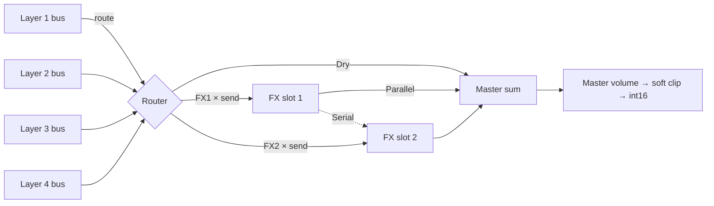

# 11 — Effects

## 1. Recommendation

Implement the **Protein's nine effect types** for parity — Chorus, Flanger, Phaser,
Tremolo, Drive, Compressor, EQ, Delay, Reverb — in **two global slots**, as on the
Protein. Then add several low-cost features for the Modern bank (10) and Move
users:

| # | Addition | Why |
|---|----------|-----|
| 1 | **Any type in either slot** (Protein: no two delays at once) | Memory is not a constraint on Move (≈ 1.6 MB for both slots) |
| 2 | **Serial chain** option (FX1 → FX2) | Drive → Reverb, Comp → Reverb, Delay → Reverb are standard modern chains |
| 3 | **Crush** mode in Drive (sample-rate + bit reduction) | Lo-fi / glitch without using another FX slot |
| 4 | **Pump** shape in Tremolo (tempo-synced duck curve) | "Sidechain" pumping with no sidechain input |
| 5 | **Freeze** at Reverb Decay = max, plus EQ Q and Low Cut | Ambient/drone presets; cleaner low end |
| 6 | **Shimmer** — reverb with a pitch shifter in its feedback loop | Ambient pads and drones; ≈ +20 µs over Reverb |
| 7 | **Trance Gate** — tempo-locked 16-step amplitude gate with rhythmic pattern presets | Classic trance chops with editable timing and envelope shape; negligible CPU and no delay memory |

Not implemented (and why) is in §6. Anything beyond this belongs in Schwung's own
audio-FX positions after Amino in the slot chain.

## 2. Architecture

- Each layer has `route` (Dry / FX1 / FX2) and `send` (0–1, a matrix target).
  A layer routed to an FX is **not** also sent dry; the slot's `mix` sets the
  dry/wet balance inside the slot.
- Global `fx_chain`: **Serial** (default) or **Parallel**. In Serial, FX1's output
  feeds FX2 (summed with any layers routed directly to FX2) instead of the master.
- All processing is stereo float. Mono-in effects (Drive, Comp, EQ) process L/R
  with linked detection.
- `mix` = equal-power dry/wet for time-based FX; linear blend for Drive, Comp,
  EQ, Tremolo and Trance Gate (so Comp at 50 % is parallel compression).

## 3. Realtime & memory rules

- Each slot owns a preallocated **arena** (≈ 800 KB) sized for the largest type
  (2 s stereo delay). All types draw buffers from it; no allocation after
  `create_instance`.
- **Type change** (knob or state load):
  1. Fade the slot's wet output out over 20 ms.
  2. Clear the arena **incrementally** — at most 64 KB per block (no whole-buffer
     `memset` on the audio thread), ≈ 13 blocks / 38 ms.
  3. Load the type's default p-values (knob change only; a state load applies its
     own p-values after `type`), fade in over 20 ms.
- p-params are smoothed (10 ms); synced Delay time changes crossfade fixed read
  taps, avoiding Doppler sweeps on tempo changes. Synced Flanger/Tremolo phases
  ease back onto the transport after stop/resume.
- Tails continue when a layer's route changes; the old slot simply stops receiving
  input.
- A slot with `type = Off` or (`mix = 0` and tail below −90 dBFS for 1 s) is
  skipped (zero CPU).
- Tempo sync uses `host->get_beat_position()` / BPM; when NULL or stopped, the
  last known BPM, then Move's set tempo (`move_info`), then 120 BPM.
- Denormal protection: flush-to-zero on, plus tiny DC offset in feedback paths.

## 4. Parameters

Every slot exposes `fxN_type`, `fxN_mix`, `fxN_p1`..`fxN_p6` (float 0..1 on the
wire; see 04 §5 for why keys are generic). Below: what each p means per type, its
display range/curve, and the default loaded on a type change. Stepped p-params
quantise the 0..1 value to the listed options.

### 4.1 Chorus
Two (Chorus) or three (Ensemble) modulated fractional delay taps per channel,
cubic interpolation, L/R LFOs offset by Spread.

| p | Name | Range | Default |
|---|------|-------|---------|
| 1 | Rate | 0.05–5 Hz (exp) | 0.6 Hz |
| 2 | Depth | 0–100 % | 40 % |
| 3 | Delay | 2–30 ms | 8 ms |
| 4 | Feedback | −90..+90 % | 0 % |
| 5 | Spread | 0–180° | 90° |
| 6 | Mode | Chorus / Ensemble | Chorus |

### 4.2 Flanger
Single modulated short delay with feedback, through-zero not required.

| p | Name | Range | Default |
|---|------|-------|---------|
| 1 | Rate | 0.02–10 Hz (exp), or division when Sync ≠ Off | 0.25 Hz |
| 2 | Depth | 0–100 % | 60 % |
| 3 | Feedback | −95..+95 % | +50 % |
| 4 | Delay | 0.1–10 ms | 1.5 ms |
| 5 | Spread | 0–180° | 90° |
| 6 | Sync | Off, 1/16, 1/8, 1/4, 1/2, 1 bar, 2, 4 bars | Off |

### 4.3 Phaser
Cascade of first-order all-passes with feedback, LFO sweeps around Center.

| p | Name | Range | Default |
|---|------|-------|---------|
| 1 | Rate | 0.02–10 Hz (exp) | 0.3 Hz |
| 2 | Depth | 0–100 % | 60 % |
| 3 | Feedback | −95..+95 % | +40 % |
| 4 | Stages | 4 / 6 / 8 / 12 | 6 |
| 5 | Center | 100 Hz–4 kHz (exp) | 700 Hz |
| 6 | Spread | 0–180° | 90° |

### 4.4 Tremolo / Autopan
Gain modulation; Stereo = 0 is tremolo, 1 is full autopan. The gain passes a
2-pole ≈ 1 ms smoother so Square, Saw and Pump edges do not click.

| p | Name | Range | Default |
|---|------|-------|---------|
| 1 | Rate | 0.1–20 Hz (exp), used when Sync = Off | 4 Hz |
| 2 | Depth | 0–100 % | 50 % |
| 3 | Shape | Sine, Tri, Square, SawUp, SawDn, **Pump** | Sine |
| 4 | Sync | Off, 1/32, 1/16T, 1/16, 1/8T, 1/8, 1/4T, 1/4, 1/2, 1 bar | Off |
| 5 | Stereo | 0–100 % | 0 % |
| 6 | Phase | 0–360° (offset vs. beat) | 0° |

**Pump**: gain = 1 − Depth · e^(−t/τ) restarted every Sync division, τ = 18 % of
the division, so the duck is fast and the recovery smooth. Locked to the bar
when the transport runs.

### 4.5 Drive
Waveshaper with pre high-pass and post tone filter. Soft/Tube/Hard/Fold are
anti-aliased with first-order ADAA (antiderivative of the shaper; ≈ 9 dB less
aliasing at +24 dB gain, measured in the emulator) or run 2× oversampled — pick by
CPU test.

| p | Name | Range | Default |
|---|------|-------|---------|
| 1 | Gain | 0–36 dB | 12 dB |
| 2 | Tone | dark ↔ bright tilt, ±6 dB @ 1 kHz pivot | 0 |
| 3 | Type | Soft, Tube, Hard, Fold, **Crush** | Soft |
| 4 | Output | −24..0 dB | −6 dB |
| 5 | Low Cut | 20–500 Hz (exp) — pre-drive, keeps lows clean | 20 Hz |
| 6 | Crush | Crush only: 0 = 44.1 kHz/16 bit → 1 = 2 kHz/4 bit | 0.3 |

### 4.6 Compressor
Stereo-linked feed-forward, RMS/peak blend detector, soft knee.

| p | Name | Range | Default |
|---|------|-------|---------|
| 1 | Threshold | −40..0 dB | −18 dB |
| 2 | Ratio | 1:1–20:1 (exp) | 4:1 |
| 3 | Attack | 0.1–100 ms (exp) | 10 ms |
| 4 | Release | 10–1000 ms (exp) | 150 ms |
| 5 | Makeup | 0–24 dB | 6 dB |
| 6 | Knee | 0–12 dB | 6 dB |

### 4.7 EQ
Low shelf (120 Hz), peaking mid, high shelf (8 kHz), and a 12 dB/oct low cut.

| p | Name | Range | Default |
|---|------|-------|---------|
| 1 | Low | ±15 dB | 0 |
| 2 | Mid | ±15 dB | 0 |
| 3 | Mid Freq | 200 Hz–8 kHz (exp) | 1 kHz |
| 4 | High | ±15 dB | 0 |
| 5 | Mid Q | 0.3–4 | 0.9 |
| 6 | Low Cut | 20–300 Hz (exp) | 20 Hz |

### 4.8 Delay
Stereo delay, fractional read with slewed time, tone filter in the feedback
loop, cross-feed for ping-pong, tape-style wow.

| p | Name | Range | Default |
|---|------|-------|---------|
| 1 | Time | 1–2000 ms (exp), used when Sync = Off | 350 ms |
| 2 | Sync | Off, 1/32, 1/16T, 1/16, 1/16d, 1/8T, 1/8, 1/8d, 1/4T, 1/4, 1/4d, 1/2, 1 bar | 1/8d |
| 3 | Feedback | 0–100 % (soft limiter in loop) | 40 % |
| 4 | Tone | LP 1–20 kHz ↔ HP 20–1000 Hz (bipolar, centre = flat) | slightly dark |
| 5 | Ping-Pong | 0–100 % cross-feed | 0 % |
| 6 | Mod | 0–100 % wow depth | 10 % |

Synced times longer than 2 s are halved until they fit.

### 4.9 Reverb
8-line feedback delay network (Hadamard), true-stereo input (L and R each get a
pre-delay and 4 all-pass diffusers, feeding the even / odd lines), every line
length modulated by its own LFO (0.5–1 Hz, staggered phases) against modal
ringing, damping in the loop.

| p | Name | Range | Default |
|---|------|-------|---------|
| 1 | Size | 0–100 % (line-length scale) | 60 % |
| 2 | Decay | 0.2–20 s (exp); **1.0 = Freeze** | 2.5 s |
| 3 | Damping | 0–100 % | 50 % |
| 4 | Pre-Delay | 0–200 ms | 20 ms |
| 5 | Mod | 0–100 % | 30 % |
| 6 | Width | 0–100 % | 100 % |

Size changes adjust the line lengths while the reverb is active; maximum-size
storage is reserved when the effect is allocated so this remains click-free.

**Freeze**: loop gain 1.0, damping and input muted, so the tail holds
indefinitely; turning Decay below max releases it. Freeze is a **performance
gesture**: a preset stored at Decay = max would receive no input and stay silent,
so factory presets never store it (the emulator caught this in preset 112).

### 4.10 Shimmer
The Reverb FDN (4.9) with a time-domain pitch shifter inserted in the feedback
path of lines 1–4: each pass is shifted by Interval, so octaves stack upward.

Shifter: per channel, two read taps sweeping an 80 ms delay line in opposite
phase with raised-cosine crossfades ("Doppler" shifter), plus slight random
jitter of the sweep period (Mod) to smear the periodic artefacts. No FFT.

Loop safeguards:
- Shifted signal passes a one-pole LP (6 kHz) and HP (150 Hz) before re-entry.
- Soft limiter on the shifted feed; total loop gain capped at 0.98.
- Decay = max (Freeze) fades Shimmer amount to 0 over 200 ms to stop runaway
  energy build-up; restored when Decay drops.

| p | Name | Range | Default |
|---|------|-------|---------|
| 1 | Size | 0–100 % | 70 % |
| 2 | Decay | 0.2–20 s (exp); 1.0 = Freeze | 6 s |
| 3 | Damping | 0–100 % | 40 % |
| 4 | Shimmer | 0–100 % share of the loop sent through the shifter | 40 % |
| 5 | Interval | −12, +5, +7, +12, +19, +24 st | +12 |
| 6 | Mod | 0–100 % | 40 % |

Pre-delay fixed at 20 ms and width at 100 % (no free p-slot); use Reverb when
those matter.

### 4.11 Trance Gate
Tempo-locked 16-step amplitude gate. Each pattern is a 16-step on/off mask that
loops over two bars at 1/8, one bar at 1/16, or half a bar at 1/32. With transport
running, the pattern follows the host beat position; with transport stopped it
continues at the current BPM. The selected pattern starts on the first step of
the grid.

| p | Name | Range | Default |
|---|------|-------|---------|
| 1 | Pattern | Classic 8ths, Offbeat 8ths, 16th Pulse, 32nd Stutter, Rolling Trance, Broken Rave, Long Gate | Classic 8ths |
| 2 | Timing | 1/8, 1/16, 1/32 | 1/16 |
| 3 | Attack | 0–50 ms, linear fade-in at each open step | 2 ms |
| 4 | Release | 0–50 ms, linear fade-out before each closed step | 8 ms |
| 5 | Gate Length | 0–100 % of each active step | 60 % |
| 6 | Floor | 0–100 % signal level between open steps | 0 % |

The slot's existing Mix control blends the gated and dry signals linearly. Gate
Length controls the duration of each open step; Attack and Release shape its
edges, while Floor sets the closed-step level.

## 5. CPU & memory

Per slot, per 128-frame block, A72 estimates (to be confirmed in M0/M2):

| Type | µs | Arena use |
|------|----|-----------|
| Chorus / Ensemble | 15 / 22 | 12 KB |
| Flanger | 12 | 4 KB |
| Phaser (12 stages) | 15 | — |
| Tremolo | 4 | — |
| Drive (2× OS) / Crush | 20 / 6 | — |
| Compressor | 8 | — |
| EQ | 8 | — |
| Delay | 20 | 706 KB (2 s stereo float) |
| Reverb | 110 | ≈ 330 KB |
| Shimmer | 130 | ≈ 360 KB |
| Trance Gate | < 5 | — |

Worst case two Shimmers ≈ 260 µs. The DSP budget in 03 §14 assumed 180 µs for FX,
so the total becomes ≈ 550 µs at 8 voices, still inside NFR-2 (≈ 580 µs) but with
little margin; the 16-voice CPU guard (03 §14.1) covers the rest.

## 6. Not implemented

| Effect | Reason |
|--------|--------|
| Shimmer / pitch-shift reverb | **Now implemented** as type 10 (§4.10) |
| Standalone pitch shifter | Artefacts are exposed without a reverb to hide them |
| Granular / spectral | CPU, scope; not part of the Protein |
| Multiband compression | Not needed for a single instrument |
| Convolution | IR files mean file I/O and large memory |
| External sidechain | No sidechain input available to a chain synth; Pump covers it |
| More than two slots | Protein parity; users can add Schwung audio FX after Amino |

FX remain **not** matrix targets (as on the Protein), except layer `send`. All
FX params are in `chain_params`, so Schwung scenes, chain LFOs and automation can
still move them.

## 7. UI

- **FX** overview page: `[FX1 Type FX1 Mix FX2 Type FX2 Mix | Chain L1 Route L1 Send Master]`
  (single-layer view; multi-layer routing lives on Layer Route).
- **FX 1** / **FX 2** pages: one type-gated level per type (05 §4.13), e.g. Delay
  `[Type Mix Time Sync | Fdbk Tone PingP Mod]`.
- Enum-like p-params (Mode, Sync, Shape, Type, Stages) are declared on their
  type level as `type: "enum"` with options, mapped to the same p-key, so they
  turn in steps and open option lists.
- Cards: Delay Time shows ms and the nearest musical division; Reverb Decay shows
  seconds or `FREEZE`.

## 8. Tests

- Impulse responses per type and default setting, compared to goldens.
- Feedback stability: every type at maximum feedback/decay for 60 s, no blow-up
  (Freeze excepted, which must stay at constant level ±0.5 dB).
- Shimmer: Shimmer 100 %, Interval +24, Decay 0.99 for 5 min with a sustained
  chord — output stays below −1 dBFS and contains no DC or sub-20 Hz build-up.
- Trance Gate: verify all patterns at 1/8, 1/16 and 1/32 against the host beat
  position; verify gate length, attack/release, floor, and dry/wet mix endpoints.
- Type-change sweep: change type every 50 ms for 30 s — no clicks above −60 dBFS,
  no allocation (malloc interposer), no block over budget.
- Tempo: synced Delay/Tremolo/Flanger stay phase-locked over 5 minutes against
  the host beat position.
